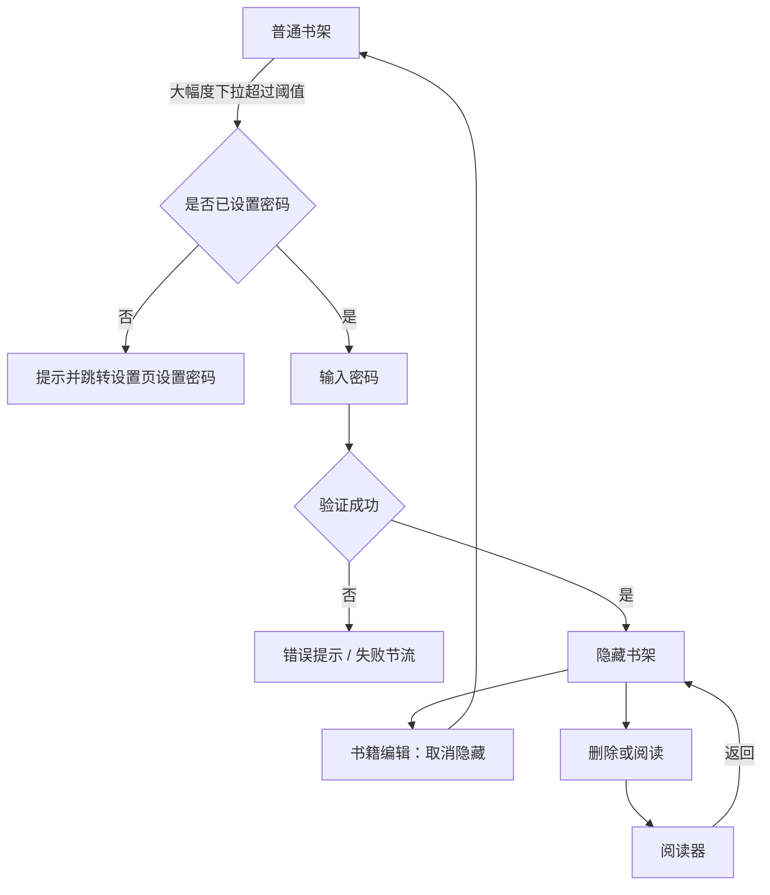
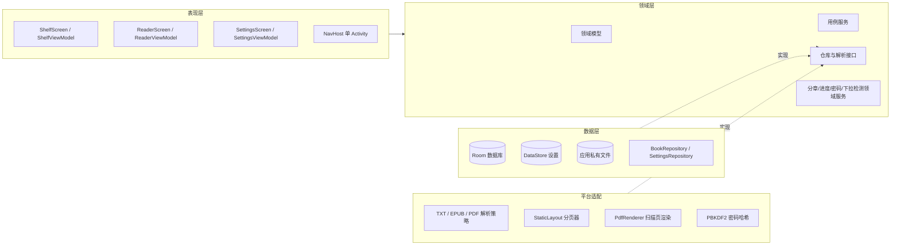
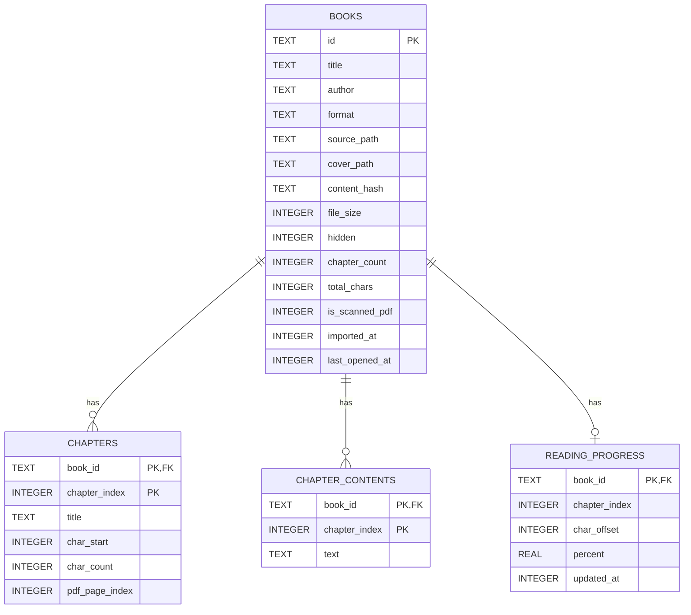
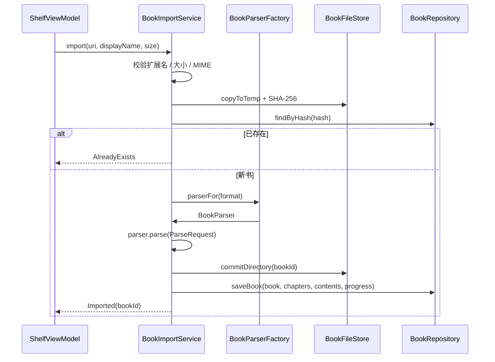
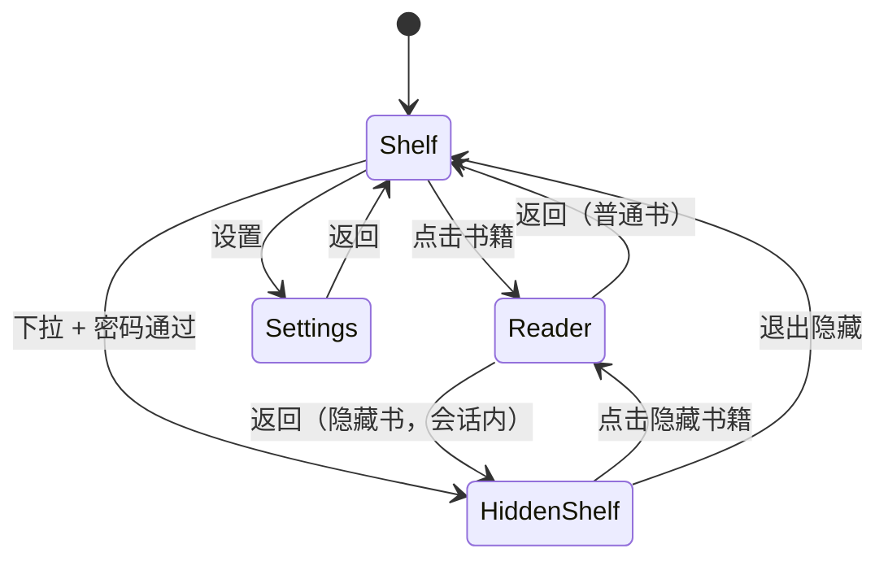

# 墨阅（MoYue）离线小说阅读器 · 设计文档

| 项目 | 内容 |
| --- | --- |
| 应用名称 | 墨阅（MoYue Reader） |
| 包名 | `com.moyue.reader` |
| 目标设备 | Xiaomi 15 Ultra，Xiaomi HyperOS 3.0.314.0 及以上 |
| 技术栈 | Kotlin + Jetpack Compose + Room + DataStore（纯离线，无网络权限） |
| 文档版本 | v1.0 |
| 状态 | 已评审，可进入实现 |

---

## 1. 背景与目标

"墨阅"是一款完全离线的本地小说阅读器：用户从手机本地磁盘导入 TXT / EPUB / PDF 电子书，在书架上管理书籍，以可定制的排版沉浸阅读，并自动保存阅读进度。应用同时提供"隐藏书架"：通过书架页大幅度下拉并输入密码进入，用于收纳不希望出现在普通书架上的书籍。

### 1.1 产品目标

1. **离线可用**：不申请网络权限，书籍、封面、进度、设置全部保存在应用私有目录。
2. **格式可扩展**：TXT / EPUB / PDF 统一抽象为内部"章节 + 文本 / 页面"模型，未来新增格式只需实现解析策略。
3. **阅读体验优先**：字号、字体、行距、主题、翻页方式可调；阅读进度以字符锚点保存，改变排版后不丢进度。
4. **隐私可控**：隐藏书架入口隐蔽，密码只保存加盐慢哈希；无明文密码、无网络上传。

### 1.2 成功标准

- 三种格式均可导入、打开、显示目录、跳章/跳页并记住进度。
- 阅读排版调整后重新分页，进度仍落在原文字位置。
- 普通书架与隐藏书架互相隔离；隐藏书籍在普通书架、搜索结果和普通书架持久化数据中不可见。
- 全量单元测试与集成测试通过，APK 可在目标设备/模拟器安装运行。

---

## 2. 已澄清的需求决策

原需求中存在以下不确定性，已与需求方确认：

| 编号 | 问题 | 决策 | 影响 |
| --- | --- | --- | --- |
| D-01 | PDF 如何阅读与分章 | **文本型 PDF 提取文字并重排**，参与字体/行距/主题设置；**扫描版 PDF 无文字层时降级为逐页位图渲染**，仍可翻页、跳页、记录进度 | PDF 解析器需要区分文本层与扫描件 |
| D-02 | "上下翻页"含义 | **上下连续滚动**（整页纵向连续排列），与左右分页共用同一分页模型 | 垂直模式使用 LazyColumn 连续滚动 |
| D-03 | 导入文件处理 | **复制到应用私有目录**，源文件移动/删除不影响阅读 | 删除书籍时同时删除副本 |
| D-04 | 忘记隐藏书架密码 | **允许清空隐藏书架数据并重设密码**，需要二次确认；不能找回原密码 | 设置页提供"清空隐藏书架并重置密码" |

---

## 3. 范围

### 3.1 v1 范围内

- 本地导入、复制、删除 TXT / EPUB / PDF 书籍。
- 书架网格、书籍名、阅读进度（百分比 + 章节名）、最近阅读排序。
- 隐藏书架：下拉解锁、设置/修改密码、隐藏/取消隐藏、删除、清空重置。
- 阅读：分页/连续滚动、目录、跳章、全页跳页、自动记录进度、恢复进度。
- 排版：4 套主题（含明亮的羊皮纸日间与纯黑夜间）、字体族、字号、行距、页边距。
- 阅读设置持久化；隐藏密码加盐哈希存储。
- 单元测试、Robolectric 集成测试、Compose 仪器测试（可选）、用户黑盒测试指南。

### 3.2 v1 范围外（明确不做）

| 条目 | 原因 / 后续扩展点 |
| --- | --- |
| 在线书源、云同步、账号系统 | 纯离线产品定位 |
| 听书 / TTS / 词典 / 批注 / 划线分享 | 非本期核心 |
| DRM / 加密 EPUB、需密码打开的 PDF | 法务与技术复杂度高，v1 给出友好错误 |
| 固定版式 EPUB、漫画/图集 EPUB | v1 只做文字流阅读；图片策略可替换 |
| 导入自定义字体文件 | v1 使用系统字体族；`FontFamilyOption` 可扩展 |
| PDF 缩放、批注、文字选择 | v1 以"适配宽度"显示扫描页 |
| 阅读亮度调节、护眼定时 | 可后续增加 |
| 多语言 UI | 中文优先，文案集中在 `strings.xml`，便于国际化 |

---

## 4. 需求追踪矩阵

| 需求 ID | 需求描述 | 设计章节 | 自动化测试 | 黑盒用例 |
| --- | --- | --- | --- | --- |
| R-READ-01 | 支持 TXT / EPUB / PDF | §10 | `TxtParserTest`、`EpubParserTest`、`PdfParserTest`、`BookImportServiceTest` | BB-01/02/03 |
| R-READ-02 | 调整字体、字号、行距 | §11、§12 | `ReaderSettingsTest`、`PaginationTest`、`ReaderViewModelTest` | BB-09 |
| R-READ-03 | 至少日间与夜间两种样式 | §14 | `ReaderThemeTest`、Compose UI 测试 | BB-10 |
| R-READ-04 | 左右翻页、上下滚动 | §11/§12 | `ReaderViewModelTest`（模式切换） | BB-11 |
| R-READ-05 | 目录及目录跳转 | §12 | `ChapterNavigationTest`、`ReaderViewModelTest` | BB-07 |
| R-READ-06 | TXT / PDF 按内容关键字分章 | §10.3/§10.6 | `ChapterSplitterTest`、`PdfParserTest` | BB-01/03 |
| R-READ-07 | 按页数跳转 | §11.5 | `PageIndexTest`、`ReaderViewModelTest` | BB-08 |
| R-READ-08 | 自动记录进度 | §11.6 | `ProgressCalculatorTest`、`ProgressRoundTripTest` | BB-06 |
| R-SHELF-01 | 显示所有书籍 / 书名 / 进度 | §13.1 | `BookDaoTest`、`ShelfViewModelTest` | BB-04 |
| R-SHELF-02 | 添加 / 删除书籍 | §10、§13.2 | `BookImportServiceTest`、`ShelfViewModelTest` | BB-01/05 |
| R-HIDE-01 | 大幅下拉弹出密码框 | §13.3 | `PullDownUnlockDetectorTest` | BB-12 |
| R-HIDE-02 | 编辑书籍可隐藏/取消隐藏 | §13.2 | `ShelfViewModelTest`、`BookDaoTest` | BB-13 |
| R-HIDE-03 | 设置页设置密码 | §13.4 | `PasswordHasherTest`、`HiddenShelfManagerTest` | BB-14 |
| R-HIDE-04 | 密码加盐哈希存储 | §13.4 | `PasswordHasherTest`、`PasswordStoreTest` | BB-14 |
| NFR-01 | 纯离线、私有存储 | §9、§16 | Manifest/依赖静态检查 | BB-15 |

---

## 5. 关键用户流程

### 5.1 首次导入并阅读

```mermaid
flowchart TD
    A[书架页点击"导入"] --> B[系统文件选择器 SAF]
    B --> C[逐本复制到私有目录并计算 SHA-256]
    C --> D{扩展名/大小/重复校验}
    D -- 失败 --> E[展示具体错误，不留下脏文件]
    D -- 成功 --> F[按格式选择 BookParser]
    F --> G[TXT 编码识别 + 分章 / EPUB 解包 + 目录 / PDF 文本层判断]
    G --> H[写入 Room：书籍、章节、正文、初始进度]
    H --> I[书架刷新]
    I --> J[点击书籍]
    J --> K[加载章节 + 全书分页]
    K --> L[恢复字符锚点进度，进入阅读]
```

### 5.2 隐藏与解锁



---

## 6. 总体架构

采用 **单 Activity + Compose + MVVM + 单向数据流**，按职责分为表现层、领域层、数据层与平台层。整体保持"干净架构"的依赖方向：`ui → domain ← data`，`domain` 不依赖 Android UI 框架（分页器等平台相关能力通过接口注入）。



### 6.1 面向对象设计原则落地

| 原则 | 落地方式 |
| --- | --- |
| **SRP 单一职责** | `BookImportService` 只编排导入；`TxtParser/EpubParser/PdfParser` 只负责格式解析；`ChapterSplitter` 只负责分章；`PageIndexBuilder` 只负责分页索引；`ProgressCalculator` 只负责进度换算；UI 不直接访问数据库或文件。 |
| **OCP 开闭原则** | 新格式只需新增 `BookParser` 实现并注册到 `BookParserFactory`，导入服务和 UI 不改。新主题、新翻页模式通过枚举 + 策略扩展。 |
| **LSP 里氏替换** | 所有 `BookParser` 遵守同一契约：返回稳定排序章节、非空标题、完整字符偏移；失败抛出 `BookParseException`，不返回半成品。测试以接口为单位复用契约测试。 |
| **ISP 接口隔离** | `BookRepository`、`ReadingSettingsRepository`、`HiddenShelfRepository`、`BookParser`、`PageBreaker`、`TextMeasurer`、`Clock` 等接口保持最小化，便于替换和测试。 |
| **DIP 依赖倒置** | ViewModel 只依赖领域接口；Room、DataStore、PDFBox、Android StaticLayout 等实现由 `AppContainer` 在组合根注入。 |

### 6.2 使用的设计模式

- **Repository**：隔离 Room / DataStore / 文件系统。
- **Strategy**：`BookParser`（TXT/EPUB/PDF）、`PageBreaker`（真实 Android / 测试假实现）、`PasswordHasher`（PBKDF2）。
- **Factory**：`BookParserFactory`、`BookFormat.fromFileName()`。
- **Adapter**：`PdfBoxTextExtractor` 适配 PDFBox，`AndroidTextMeasurer` 适配 StaticLayout。
- **State**：`ReaderUiState` 密封状态（Loading / Ready / Error），杜绝非法状态组合。
- **Observer**：DAO 返回 `Flow`，书架与进度自动刷新。
- **Value Object**：`ReadingAnchor`、`PageIndexSignature`、`PageLayoutSpec` 等不可变值对象（v1 以数据类实现）。

### 6.3 技术栈与版本基线

| 组件 | 选型 |
| --- | --- |
| 语言 | Kotlin 2.0.x |
| UI | Jetpack Compose + Material 3 |
| 数据库 | Room 2.6.x（KSP） |
| 设置 | DataStore Preferences |
| 异步 | Kotlin Coroutines + Flow |
| EPUB HTML | Jsoup（清洗 HTML 为纯文本） |
| PDF 文本 | PDFBox-Android 2.0.x |
| PDF 渲染 | Android `PdfRenderer` |
| 导航 | Navigation Compose（单 Activity） |
| 测试 | JUnit4、kotlinx-coroutines-test、Robolectric、Compose UI Test |

> 构建基线：`compileSdk 35 / targetSdk 35 / minSdk 26`，JDK 17 字节码。HyperOS 3（Android 16）向下兼容该 targetSdk。

---

## 7. 模块与包结构

```
com.moyue.reader
├── MoYueApplication.kt          // PDFBox 初始化、AppContainer 组合根
├── MainActivity.kt              // 单 Activity、edge-to-edge、NavHost
├── core/
│   ├── AppContainer.kt          // 手写依赖注入容器（无 Hilt）
│   ├── DispatcherProvider.kt    // 可替换调度器，测试注入 Unconfined
│   ├── Result.kt                // 领域结果类型 BookResult
│   └── Time.kt                  // Clock 抽象
├── domain/
│   ├── model/                   // Book, Chapter, ReadingProgress, ReaderSettings,
│   │                            // ReaderTheme, FontFamilyOption, PageMode, BookFormat, ...
│   ├── repository/              // BookRepository, SettingsRepository, HiddenShelfRepository 接口
│   ├── parser/                  // BookParser, ParsedBook, ParseRequest, BookParserFactory
│   ├── reader/                  // PageIndexBuilder, ReaderPageIndex,
│   │                            // PageIndexCache / PageIndexSignature 契约
│   ├── service/
│   │   ├── BookImportService.kt
│   │   ├── ChapterSplitter.kt
│   │   ├── ProgressCalculator.kt
│   │   ├── HiddenShelfManager.kt
│   │   ├── PullDownUnlockDetector.kt
│   │   └── UnlockThrottle.kt
│   └── crypto/                  // PasswordHasher 接口与哈希值对象
├── data/
│   ├── db/                      // AppDatabase, entities, DAOs
│   ├── repository/              // RoomBookRepository, DataStoreSettingsRepository,
│   │                            // SharedPreferencesPasswordStore
│   ├── file/                    // BookFileStore（私有目录/封面/缓存/清理）
│   ├── cache/                   // FilePageIndexCache（页索引文件缓存）
│   └── parser/                  // TxtParser, EpubParser, PdfParser, 编码检测, HTML清洗
├── platform/
│   ├── pagination/              // AndroidPageBreaker, StaticLayout 页边界计算
│   ├── pdf/                     // PdfBoxTextExtractor, PdfPageRenderer
│   └── crypto/                  // Pbkdf2PasswordHasher
└── ui/
    ├── theme/                   // 设计系统、ReaderTheme 颜色映射
    ├── navigation/              // 路由
    ├── components/              // 通用组件：封面、进度条、空状态、对话框
    ├── shelf/                   // ShelfScreen + ShelfViewModel（普通/隐藏共用）
    ├── hidden/                  // 密码解锁对话框、密码设置组件
    ├── reader/                  // ReaderScreen + ReaderViewModel、翻页、目录、跳页、设置面板
    └── settings/                // SettingsScreen + SettingsViewModel
```

---

## 8. 领域模型

```kotlin
enum class BookFormat { TXT, EPUB, PDF }

enum class PageMode { HORIZONTAL, VERTICAL }          // 左右翻页 / 上下滚动
enum class ReaderTheme { PARCHMENT, NIGHT, GREEN, WHITE }
enum class FontFamilyOption { DEFAULT, SERIF, SANS, MONOSPACE }

data class Book(
    val id: String,                               // UUID，同时作为私有目录名
    val title: String,
    val author: String?,
    val format: BookFormat,
    val contentHash: String,                      // SHA-256，用于去重
    val coverPath: String?,                       // 相对 filesDir；为空时生成文字封面
    val hidden: Boolean,
    val chapterCount: Int,
    val totalChars: Int,
    val isScannedPdf: Boolean,
    val importedAt: Long,
    val lastOpenedAt: Long?,
)

data class Chapter(
    val index: Int,
    val title: String,
    val charStart: Int,                           // 在全书文本中的累计起点
    val charCount: Int,
    val text: String,                             // 扫描版 PDF 为空
    val pdfPageIndex: Int?,                       // 扫描版 PDF：对应原 PDF 页
)

data class ReadingProgress(
    val chapterIndex: Int,
    val charOffsetInChapter: Int,                 // 文本锚点；扫描 PDF 恒为 0
    val percent: Float,                           // 0f..1f
    val updatedAt: Long,
)

data class ReadingAnchor(                          // 排版变化后恢复位置
    val chapterIndex: Int,
    val charOffsetInChapter: Int,
    val pdfPageIndex: Int?,
)

data class ReaderSettings(
    val theme: ReaderTheme = ReaderTheme.PARCHMENT,
    val fontSizeSp: Float = 18f,
    val lineHeightMultiplier: Float = 1.8f,
    val fontFamily: FontFamilyOption = FontFamilyOption.SERIF,
    val pageMode: PageMode = PageMode.HORIZONTAL,
    val horizontalPaddingDp: Int = 24,
)
```

**约束**（由领域服务校验）：

- `fontSizeSp ∈ [14, 32]`，步长 1。
- `lineHeightMultiplier ∈ [1.2, 2.4]`，步长 0.1。
- `horizontalPaddingDp ∈ [16, 40]`。
- `ReadingProgress.percent` 以字符累计位置计算，不使用页数，避免排版变化导致进度跳变。
- 扫描版 PDF 的进度以原始页序号计算。

---

## 9. 数据设计

### 9.1 Room 数据库（version 1）



设计说明：

- **正文与章节目录分表**：打开书籍只需读取章节元数据；阅读时按章读取正文，降低大书内存占用。
- `source_path` / `cover_path` 保存**相对路径**，避免应用重装或备份恢复后绝对路径失效（虽然 v1 禁止备份）。
- `content_hash` 唯一索引：SHA-256 去重，重复导入直接提示"已在书架中"。
- `hidden` 布尔字段 + 复合索引 `(hidden, last_opened_at)`：普通/隐藏书架各自高效排序。
- 外键 `ON DELETE CASCADE`：删除书籍自动清除章节、正文、进度。
- `ReadingProgress` 与书籍一对一，初始进度在导入时创建（0%）。
- 数据库仅存**元数据 + 纯文本**；原始文件留在私有目录，供扫描版 PDF 渲染与将来重新解析。

### 9.2 DataStore（阅读设置）

| Key | 类型 | 默认值 | 说明 |
| --- | --- | --- | --- |
| `theme` | String | `PARCHMENT` | 阅读主题 |
| `font_size_sp` | Float | 18 | 字号 |
| `line_height` | Float | 1.8 | 行高倍数 |
| `font_family` | String | `SERIF` | 字体族 |
| `page_mode` | String | `HORIZONTAL` | 翻页模式 |
| `horizontal_padding_dp` | Int | 24 | 左右页边距 |

设置读取使用 `Flow<ReaderSettings>`，非法/越界值回退默认并记录日志。

### 9.3 隐藏密码存储

使用独立 `SharedPreferences("hidden_shelf_security")`（MODE_PRIVATE），保存：

| Key | 内容 |
| --- | --- |
| `version` | 哈希格式版本（当前 1） |
| `algorithm` | `PBKDF2WithHmacSHA256` |
| `iterations` | 120000 |
| `salt_b64` | 16 字节随机盐，Base64 |
| `hash_b64` | 32 字节派生密钥，Base64 |

- **绝不保存明文密码**，也不将密码写入日志、崩溃信息或导航参数。
- 校验使用 `MessageDigest.isEqual` 常量时间比较。
- 修改密码必须先验证旧密码；忘记密码只能清空隐藏书架并重置（D-04）。
- 密码长度 4–64 个字符（含中文、符号），设置页实时校验。
- 解锁失败节流：连续 5 次失败后冷却 30 秒（`UnlockThrottle`，内存态，进程重启重置）。

### 9.4 私有文件布局

```
filesDir/
└── books/
    └── {bookId}/
        ├── source.txt | source.epub | source.pdf    # 原始文件副本
        ├── cover.img                                 # EPUB 封面（可选，按原始字节保存）
        └── pagination/                               # 页索引缓存（派生数据，可重建）
            └── {signature}.idx                       # 一种排版一个文件
cacheDir/
└── pdf_pages/{bookId}/                               # 可选位图缓存，系统可随时清理
```

- 导入先写 `source.importing` 临时文件，解析与去重全部成功后再原子重命名到正式目录并入库。
- 删除书籍：先删数据库事务，再递归删除目录；文件删除失败只记录日志，不阻塞 UI（下次启动可清理孤儿目录）。
- 不向公共存储写入任何文件；不申请存储权限（使用 SAF）。

---

## 10. 导入与解析设计

### 10.1 导入流水线



- 支持多选导入；逐本串行处理（避免大文件并发占用内存），每本展示进度/结果。
- 书名优先级：文件显示名（去扩展名）→ EPUB 元数据 title → "未命名书籍"。
- 作者：EPUB `dc:creator`；TXT/PDF 解析文件名中 `作者：xxx` / `by xxx`；否则空。
- 失败时清理临时文件，UI 显示错误原因（格式不支持、文件过大、加密、损坏、重复）。
- 文件大小限制：TXT/EPUB ≤ 40 MB，PDF ≤ 300 MB；超限给出明确提示。

### 10.2 格式识别

以 **文件扩展名为主、MIME 为辅**：

| 扩展名 | MIME 示例 | 解析器 |
| --- | --- | --- |
| `.txt` | `text/plain` | `TxtParser` |
| `.epub` | `application/epub+zip` | `EpubParser` |
| `.pdf` | `application/pdf` | `PdfParser` |

扩展名缺失时尝试 MIME；两者都不支持则拒绝。文件头校验：
- EPUB 必须是合法 ZIP 且包含 `META-INF/container.xml`。
- PDF 必须以 `%PDF-` 开头。
- TXT 不强制文件头。

### 10.3 文本规范化与分章

**编码识别（TXT）**：

1. BOM：UTF-8 / UTF-16LE / UTF-16BE。
2. 无 BOM 时，检测前 4 KB 的 NUL 分布，疑似 UTF-16 则按 LE/BE 解码。
3. 严格 UTF-8 解码（`CodingErrorAction.REPORT`）成功则使用 UTF-8。
4. 否则使用 GB18030（兼容 GBK/GB2312，覆盖绝大多数中文 TXT）。
5. 仍失败则 UTF-8 replacement 解码并标记警告（不阻断阅读）。

**规范化**：

- 统一换行为 `\n`，去除 UTF-8 BOM 与零宽空格。
- 合并 3 个以上连续空行为 2 个。
- 去除每行首尾的 ASCII 空白，全角缩进保留。
- 不改变正文语序、标点与段落数量。

**分章规则**（`ChapterSplitter`）：

按行扫描，候选标题必须**整行匹配**且长度 ≤ 48：

1. 中文章节：`^第[0-9零〇一二三四五六七八九十百千万两]+[章回节卷集部篇]([\s　:：、.．-].{0,40})?$`
2. 特殊标题：`序章|序言|楔子|引子|前言|后记|尾声|终章|番外…|附录…`
3. 英文章节：`^chapter\s+([0-9]+|[ivxlcdm]+)(\s*[:.\-]\s*.{0,40})?$`（忽略大小写）
4. 编号小节：`^[0-9]{1,4}[、.．]\s*\S.{0,30}$`，且前一行是空行、整行长度 ≤ 40。
5. Markdown 标题：`^#{1,3}\s+\S.{0,40}$`。

处理策略：

- 首个标题前若有非空内容，生成"前言"章节（标题取自首行，否则"前言"）。
- 每个标题开启新章节，直到下一个标题；标题作为章节名。
- **没有任何标题**时，按空行边界切分为约 6000 字符的等长章节，标题为"第 N 节"；单段超过 12000 字符时按句号/问号/叹号切分，绝不截断在字符中间（按 UTF-16 索引安全切分）。
- 章节标题去重时保留序号；最多 5000 章，超出合并尾部，避免目录与分页失控。
- 正文为空的章节合并到下一章，避免空页。

### 10.4 TXT 解析

`TxtParser` 负责：读取文件字节 → 编码探测 → 规范化 → 调 `ChapterSplitter` → 产出 `ParsedBook`。文件级别的书名/作者推断放在导入服务中，避免解析器耦合文件名。

### 10.5 EPUB 解析

1. 使用 `ZipFile` 打开副本；防御 Zip Slip（只按条目名读取，不解压到磁盘）、Zip Bomb（条目数 ≤ 10000、单条目解压 ≤ 20 MB、总计 ≤ 200 MB）。
2. `META-INF/container.xml` → OPF 路径；解析 OPF 的 `metadata`（title、creator、language）、`manifest`、`spine`。
3. 有 `META-INF/encryption.xml` 且包含加密条目 → 报"暂不支持加密/DRM 电子书"。
4. 目录优先级：
   - EPUB3：manifest 中 `properties="nav"` 的 XHTML（解析 `<nav epub:type="toc">` 的链接）。
   - EPUB2：`spine` 的 `toc` 指向的 NCX（`navMap/navPoint`）。
   - 无目录：按 spine 顺序，每项一章。
5. 链接 href 去掉锚点后与 spine 文档路径匹配，得到章节标题；同一文档的多个锚点合并为一个章节（v1 限制）。
6. 正文清洗：Jsoup 解析 XHTML，移除 `script/style/nav/head`，把 `p/div/br/h1-h6/li/tr` 等块级边界转为换行，解码实体，压缩空白，输出纯文本。
7. 封面：manifest 中 `properties="cover-image"`，或 `<meta name="cover" content="id">` 指向的图片；复制为 `cover.img`（按原始字节保存，渲染时按内容解码）。
8. 跳过纯图片页或空文本页；若全书有效文字 < 100 字符 → 报错"EPUB 中未找到可读文本"。
9. 章节标题为空时使用文档 `<title>` 或"第 N 章"。

### 10.6 PDF 解析

**文本型 PDF**：

1. PDFBox-Android 加载文档，`PDFTextStripper` 逐页提取文字，页间插入双换行。
2. 统计有效字符数；若 `< max(50, 页面数 × 10)`，判定为**扫描版**。
3. 对文本执行与 TXT 相同的分章逻辑；若 PDF 自带书签（outline）可用，可优先使用书签作为目录（可选增强）。
4. 文本参与全文分页、字体/行距/主题设置；原 PDF 版式不再保留。

**扫描版 PDF**：

1. 每个 PDF 页生成一个章节，标题"第 N 页"，`chapter.text` 为空，`pdfPageIndex = N-1`。
2. 阅读器使用 `PdfRenderer` 按页面渲染位图，适配宽度，支持左右滑动、上下连续滚动、按页跳转。
3. 字体/行距设置对页面位图不生效，UI 显示"扫描版 PDF 保留原始版式"提示；主题仅影响页面外围背景。
4. `PdfRenderer` 非线程安全：所有渲染通过单线程 `Dispatcher` 串行执行，并做页面位图 LRU 缓存。

**异常**：

- 需要密码的 PDF：捕获 `InvalidPasswordException` → "该 PDF 受密码保护，暂不支持"。
- 损坏/不支持：`BookParseException.Corrupted`。
- PDFBox 初始化在 `Application.onCreate()` 调用 `PDFBoxResourceLoader.init(context)`。

### 10.7 解析结果契约

```kotlin
data class ParsedBook(
    val title: String?,
    val author: String?,
    val format: BookFormat,
    val isScannedPdf: Boolean = false,
    val coverBytes: ByteArray? = null,
    val pages: List<ParsedChapter>,
) {
    data class ParsedChapter(
        val title: String,
        val text: String,
        val pdfPageIndex: Int? = null,
    )
}

sealed class BookParseException(message: String) : Exception(message) {
    class UnsupportedFormat(...)
    class Corrupted(...)
    class Encrypted(...)
    class TooLarge(...)
}
```

导入服务负责生成 UUID、累计字符偏移、初始进度，并将 `ParsedBook` 落库。

---

## 11. 排版与分页引擎

### 11.1 设计目标

- 分页结果与真实渲染一致（使用 `StaticLayout` 测量）。
- 前后翻页、按页跳转、TOC 跳章共用一份全书页索引。
- 字号/字体/行距/边距变化时重新分页，但阅读位置不丢。
- 分页可单元测试：核心算法与 Android 测量解耦。

### 11.2 分层

```kotlin
data class PageLayoutSpec(
    val widthPx: Int,
    val heightPx: Int,
    val fontSizePx: Float,
    val lineHeightPx: Float,
    val fontFamily: FontFamilyOption,
    val chapterTitleHeightPx: Int,
)

data class PageInfo(
    val chapterIndex: Int,
    val start: Int,                 // 章节内 UTF-16 起点（含）
    val end: Int,                   // 章节内 UTF-16 终点（不含）
    val isChapterStart: Boolean,
    val pdfPageIndex: Int? = null,
) {
    val pageKey: String get() = "$chapterIndex:$start"
}

interface PageBreaker {              // 由 Android StaticLayout 实现
    fun breakChapter(title: String, text: String, spec: PageLayoutSpec): List<PageRange>
}

class PageIndexBuilder(private val breaker: PageBreaker) {
    fun build(chapters: List<Chapter>, spec: PageLayoutSpec): ReaderPageIndex
}
```

- `PageBreaker` 使用 `StaticLayout` 对整章正文按内容宽度排版，逐行累计高度：
  - 每页最多装入 `heightPx`；首页可用高度 = `heightPx - chapterTitleHeightPx`。
  - 页边界取整行起点/终点，保证不截断行。
  - 空章节产生一个占位页（不显示空文本）。
- `PageIndexBuilder` 把所有章节的页拼接为**全局页索引**，并用数组记录每页起始字符、章节起始页，供二分查找。
- **扫描版 PDF 不分页**：页索引直接映射 `0..pageCount-1`，`PageInfo.pdfPageIndex` 有值。

### 11.3 排版签名、重排与页索引缓存

```kotlin
data class PageIndexSignature(
    val contentHash: String,        // 源文件 SHA-256
    val chapterCount: Int,
    val totalChars: Int,
    val chapterMetaHash: String,    // 章节索引/起始偏移/长度/正文长度的 SHA-256
    val layout: PageLayoutSpec,     // 可用宽高、字体、字号、行高、标题预留高度
    val engineVersion: Int,         // 页边界算法版本
)

interface PageIndexCache {
    fun load(bookId: String, signature: PageIndexSignature, chapters: List<Chapter>): ReaderPageIndex?
    fun save(bookId: String, signature: PageIndexSignature, chapters: List<Chapter>, index: ReaderPageIndex)
}
```

- 阅读页使用 `BoxWithConstraints` 获得可用宽高，扣除安全区与内边距后计算 `PageLayoutSpec`；视口只避让系统栏与刘海，**排除 IME inset**，避免跳页对话框的键盘改变正文高度并触发整本书重排。
- 签名只包含会影响页边界的输入。主题、左右/上下翻页模式不改变字符页边界，因此不参与签名，也不触发重排。
- `ReaderViewModel` 在分页前先按签名查缓存：
  - **命中**：反序列化页区间，配合当前章节重建 `ReaderPageIndex`，直接按字符锚点恢复位置，跳过 `PageBreaker`；
  - **未命中**：在 `Dispatchers.Default` 执行 `PageIndexBuilder`，完成后在 `Dispatchers.IO` 原子写入缓存，再进入阅读。
- 缓存文件位于 `filesDir/books/{bookId}/pagination/{sha256(signature)}.idx`，二进制保存页区间与章节首页标记；文件头重复保存签名，用于防哈希碰撞、版本不符与损坏文件。
- 写入先写同目录临时文件，再 `ATOMIC_MOVE` 替换；读取时严格校验魔数、格式版本、引擎版本、签名、页数上限、章节连续、页区间首尾相接/不越界/不出现非空章节空页。任一校验失败都按未命中并删除坏文件，绝不使用半截页索引截断正文。
- 每本书最多保留 4 套排版、总量 8 MB；命中时更新访问时间，写入后按 LRU 清理。删除书籍时缓存随书籍目录级联删除。
- `PAGE_INDEX_ENGINE_VERSION` 在页边界算法（StaticLayout 处理、逐行装箱、标题预留、空章节策略）变化时递增，旧缓存自动失效。
- 同一签名已经排好或正在排时，`ReaderViewModel` 直接复用现有页索引/任务，不重复启动分页；这覆盖跳页、弹窗、转场等重复视口回调。
- 重排前记录当前 `ReadingAnchor`，重排后调用 `pageIndex.pageForAnchor(anchor)` 恢复。
- 分页任务在 `Dispatchers.Default` 执行，按章 `yield()` 保持 UI 响应；首次分页提供 0–100% 进度状态。大书策略仍为一次性完成后进入阅读，在 Xiaomi 15 Ultra 上百万字目标 < 3 秒。

### 11.4 页索引 API

```kotlin
class ReaderPageIndex(
    val pages: List<PageInfo>,
    val chapterFirstPage: IntArray,
    val chapterPageCount: IntArray,
) {
    fun pageForAnchor(anchor: ReadingAnchor): Int
    fun pageForChapter(index: Int): Int
    fun chapterIndexForPage(page: Int): Int
    fun progressPercent(page: Int, chapters: List<Chapter>): Float
}
```

- `pageForAnchor`：优先按章节 + 字符偏移，在章节页范围内二分查找；扫描 PDF 按 `pdfPageIndex`。
- 进度百分比：`(chapter.charStart + min(charOffset, charCount)) / totalChars`；扫描 PDF 用页序。
- 页码显示为全局第 X / Y 页；TOC 跳转后定位到该章第一页。

### 11.5 按页数跳转

- 跳页对话框：输入框 + 滑块，范围 `1..totalPages`，校验越界；确定后 `HorizontalPager.scrollToPage` / `LazyListState.scrollToItem`。
- 同时显示章节与页码，避免大书误操作。
- 扫描 PDF 的页码即原 PDF 页。

### 11.6 阅读进度

- 触发：翻页 settled、垂直滚动停止（300 ms 防抖）、进入后台/离开阅读器时立即保存。
- 存储：`ReadingProgress(chapterIndex, charOffsetInChapter, percent, updatedAt)`。
- **锚点优先**：保存当前页起始字符偏移 + 页内实际阅读位置（v1 以页起点为准；垂直滚动取首个可见页起点）。
- 恢复：打开书籍读取进度 → `pageForAnchor` → 定位；若进度章节已不存在（重新解析后章节变化），回退到百分比最近的章节。
- 打开书籍时更新 `lastOpenedAt`，书架按最近阅读排序。
- 阅读完毕（最后一页）进度为 100%；再次打开仍停在最后一页，而不是自动回到开头。

---

## 12. 阅读器交互设计

### 12.1 界面结构

```text
┌─────────────────────────────┐
│ ← 书名            目录 ⋯   │  顶部栏（点击页面中部显示/隐藏）
│                             │
│  第一章 初见                 │  ← 章标题仅章节首页显示
│                             │
│  正文正文正文正文正文……     │  分页内容 / 连续滚动
│  正文正文正文正文正文……     │
│                             │
│ ─────────────────────────── │  底部栏
│ 22% · 第 1/58 章  第 3/1260 页  [跳页] [Aa] │
└─────────────────────────────┘
```

- 沉浸式：进入阅读器隐藏系统状态栏/导航栏，退出恢复；保持屏幕常亮。
- 点击页面中部切换顶部/底部栏；左右边缘点击翻页（左右模式）；垂直模式点击仅切换栏。
- 左右模式：`HorizontalPager` 全屏滑动，支持快速滑动；页面切换有轻微滑动动画。
- 上下模式：`LazyColumn` 连续排列整页文本；滚动停止后记录首个可见页。
- 系统返回：保存进度并回到书架；隐藏书架内的书返回隐藏书架（会话保持）。
- 顶部栏：返回、书名（单行省略）、目录。
- 底部栏：进度百分比、章节位置、全局页码、跳页按钮、阅读设置（Aa）。
- 目录：`ModalBottomSheet`，LazyColumn 展示章节标题与序号；当前章节高亮，点击跳转并关闭；显示章节总数。
- 设置面板：`ModalBottomSheet`，包含主题、翻页方式、字体、字号、行距、边距；带实时预览小卡片。字号/行距在滑动结束（`onValueChangeFinished`）后应用并重排；主题立即生效。
- 错误/加载状态：全屏加载动画带百分比；错误页提供"返回书架"与"重试"。

### 12.2 ReaderViewModel 状态

```kotlin
sealed interface ReaderUiState {
    data object Loading : ReaderUiState
    data class Paginating(val progress: Float) : ReaderUiState
    data class Ready(
        val book: Book,
        val pages: ReaderPageIndex,
        val currentPage: Int,
        val settings: ReaderSettings,
        val chromeVisible: Boolean,
    ) : ReaderUiState
    data class PdfReady(
        val book: Book,
        val pageCount: Int,
        val currentPage: Int,
        val settings: ReaderSettings,
        val chromeVisible: Boolean,
    ) : ReaderUiState
    data class Failed(val message: String) : ReaderUiState
}
```

事件：`OpenBook`、`ViewportMeasured`、`PageChanged`、`ScrollSettled`、`JumpToPage`、`JumpToChapter`、`ToggleChrome`、`UpdateSettings`、`SaveNow`、`Retry`。

### 12.3 手势与防误触

- 下拉解锁只发生在**书架顶部且向下拖动超过 140 dp** 时；拖动过程中显示锁形提示与进度，触发后立即复位并弹出密码框。
- 阅读器翻页区域不放置可滚动控件，避免手势冲突；底部栏点击不穿透。
- 跳页输入限制为数字，软键盘"完成"即提交。

### 12.4 生命周期

- `ON_STOP` 时强制保存进度。
- 阅读器 `DisposableEffect` 恢复系统栏、清除常亮标记。
- 分页/解析协程绑定 `viewModelScope`；页面销毁自动取消。

---

## 13. 书架、导入与隐藏书架

### 13.1 书架

- 两列网格（宽屏/横屏自适应三列），每项显示：封面（有封面用图片，否则按书名生成渐变文字封面）、书名（最多两行）、阅读进度条、百分比与当前章节名。
- 顶部：应用名"墨阅"、设置入口、导入按钮；底部浮动"导入本地书籍"。
- 排序：最近阅读时间倒序；从未打开的书按导入时间倒序。
- 空书架：插画式空状态 + 支持格式说明 + "导入第一本书"按钮。
- 导入中：显示每本处理状态（复制中/解析中/完成/失败）；完成后书架自动刷新。
- 点击书籍打开阅读器；长按或卡片右下角"⋯"进入编辑底部表单。
- 编辑表单：书名、格式、大小、进度；操作：隐藏/取消隐藏、删除（二次确认）。
- 删除：删除数据库记录、正文、进度、封面、源文件副本；若正在阅读则先退出。

### 13.2 隐藏/取消隐藏

- 编辑表单中的"隐藏到隐藏书架"将 `hidden=true`，书籍立即从普通书架移除并加入隐藏书架；反向操作恢复。
- 普通书架不展示任何 `hidden=true` 的书籍；隐藏书架只展示 `hidden=true`。
- 隐藏操作无需密码；进入隐藏书架需要密码。这是需求方的产品选择，文档明确记录。

### 13.3 下拉解锁

- `PullDownUnlockDetector` 纯 Kotlin 状态机：`thresholdPx`、`accumulatedPx`、`isAtTop`；向书架注入 `NestedScrollConnection`，只在顶部向下 overscroll 时累计。
- 超过阈值触发一次 `onTrigger`，随后复位；未超过时回弹。
- 若未设置密码：弹出提示"请先在设置中设置隐藏书架密码"，提供跳转按钮。
- 密码框：标题"进入隐藏书架"、密码隐藏输入、错误提示、失败冷却倒计时、取消/确认。
- 验证成功：进入隐藏书架视图（同一 `ShelfScreen` 切换模式），显示"隐藏书架"标识与"退出隐藏"入口；不写入导航参数、不写入日志。
- 退出隐藏模式立即清空 `HiddenShelfSession`；进入阅读器后返回仍处于隐藏模式（同一 ViewModel 会话）。

### 13.4 密码设置与重置

- 设置页"隐私与安全"：
  - 未设置：显示"设置隐藏书架密码"。
  - 已设置：显示"修改密码"（需旧密码）、"清空隐藏书架并重置密码"。
- 修改密码流程：输入旧密码 → 输入新密码 → 确认新密码；所有校验在领域层完成。
- 清空重置：二次确认（输入"清空"），删除所有 `hidden=true` 书籍及其文件、进度，清除密码哈希。**此操作不可恢复**。即使当前未设置密码，也可执行清空以解救被隐藏的书籍。
- 密码哈希计算在 `Dispatchers.Default` 执行，避免阻塞 UI；PBKDF2 120000 次在目标设备约百毫秒级。

### 13.5 安全边界

- 隐藏书架是**界面隐藏**，不是文件加密；已获得应用私有目录 root 权限的攻击者可读取书籍。文档明确说明，避免过度承诺。
- 无 INTERNET 权限；`allowBackup=false` 且禁用云备份，避免隐藏书籍随备份外泄。
- 密码尝试节流与常量时间比较降低暴力破解风险。
- 隐藏书籍仅在 `hidden=true` 查询中出现；普通书架的 DAO 查询强制 `hidden=0`。

---

## 14. UI/UX 设计

### 14.1 视觉语言

"墨阅"取"水墨 + 纸张"意象：温和的米纸色、墨黑、朱砂红点缀；标题使用衬线字体，正文可切换；圆角克制，留白充足。整体避免通用 Material 紫色模板感。

### 14.2 阅读主题

| ID | 名称 | 背景 | 正文 | 次要文字 | 强调色 | 说明 |
| --- | --- | --- | --- | --- | --- | --- |
| PARCHMENT | 羊皮纸（日间） | `#F5E6C8` | `#2A2118` | `#7A6A52` | `#9C4A2F` | 需求指定的黄底黑字 |
| NIGHT | 夜读 | `#0D0F12` | `#C9CBD1` | `#7B7F88` | `#C98B5E` | 黑底浅字，低蓝光 |
| GREEN | 青竹 | `#DDE8D5` | `#20301F` | `#6B7D64` | `#3F6B4A` | 护眼绿 |
| WHITE | 宣白 | `#FAFAF7` | `#1C1C1C` | `#6C6C6C` | `#8A3B2B` | 高对比日间 |

- 阅读器状态栏/导航栏颜色同步主题，图标明暗自动切换。
- 主题切换即时生效，不重排（仅颜色变化）；系统 UI 同步更新。
- 书架固定使用浅色宣纸风（不随阅读主题切换），保证品牌一致性；夜间系统下仍可读（按钮对比度 ≥ 4.5:1）。

### 14.3 排版参数

| 参数 | 范围 | 默认 | 说明 |
| --- | --- | --- | --- |
| 字号 | 14–32 sp | 18 | 步长 1 |
| 行距 | 1.2–2.4 倍 | 1.8 | 正文行高 |
| 字体族 | 默认/衬线/无衬线/等宽 | 衬线 | 使用系统字体族 |
| 左右边距 | 16–40 dp | 24 | 重新分页 |

### 14.4 无障碍与细节

- 所有图标按钮提供 `contentDescription`。
- 点击目标 ≥ 48 dp；文本对比度满足 WCAG AA。
- 支持系统字体缩放，但阅读正文使用用户设置字号，避免双重缩放导致分页异常（sp 已含系统缩放；在设置页提示超大字号可能减少每页字数）。
- 触觉反馈：下拉触发、翻页边界、密码错误。
- 动画：书架卡片进入淡入上浮；阅读页切换使用 Pager 原生动画；避免浮夸动效。

### 14.5 导航结构



导航采用 `NavHost`，隐藏模式是 `ShelfViewModel` 的 UI 状态，不单独持久化路由，防止进程重启后绕过密码直达隐藏书架。

---

## 15. 错误处理与边界

| 场景 | 行为 |
| --- | --- |
| 文件过大 | 导入前拒绝，提示格式对应上限 |
| 重复导入 | SHA-256 命中，提示书名已存在（含隐藏书架） |
| 不支持的扩展名/MIME | 拒绝并列出支持格式 |
| TXT 编码异常 | 尝试 GB18030，仍失败则替换解码并提示"部分字符可能显示异常" |
| EPUB 损坏/非 ZIP | 解析失败，清理临时文件，提示文件损坏 |
| EPUB 加密/DRM | 提示暂不支持加密电子书 |
| PDF 加密 | 提示需要密码的 PDF 暂不支持 |
| PDF 扫描件 | 自动降级逐页看图，提示保留原版式 |
| 分页过程被杀 | 未写完的缓存只有临时文件，启动后按未命中处理；下次打开重排当前排版并用字符锚点恢复，其他已缓存排版仍可命中 |
| 源文件被系统清理 | 副本在私有目录，不受影响；若私有文件丢失，打开时提示"文件丢失，请重新导入" |
| 数据库损坏 | 启动时捕获，提示重启/清除数据（v1 不自动删库） |
| 隐藏密码未设置 | 下拉提示去设置页设置 |
| 连续输错密码 | 5 次后冷却 30 秒，显示倒计时 |
| 重置隐藏书架 | 二次确认，不可恢复，同时清除密码 |
| 空内容书籍 | 导入失败，提示未找到可读文字 |
| 超长单章 | 分页仍可工作；章节数上限 5000，避免 UI 卡死 |
| 旋转/分屏尺寸变化 | 重新分页并恢复锚点 |
| 返回键 | 保存进度并退出阅读器；不弹出多余确认 |

---

## 16. 性能与兼容性

- **目标设备**：Xiaomi 15 Ultra（高性能）；最低 minSdk 26 仅保证安装兼容，实际以 HyperOS 3 为准。
- **导入**：流式复制 + 边复制边计算 SHA-256，避免二次读盘；大文件禁止并发导入。
- **分页**：StaticLayout 在后台线程；首次百万字目标 < 3 秒；页索引按“内容 + 章节 + 排版 + 引擎版本”签名持久化缓存，重开同一本书/同排版跳页不再重排；字号等排版变更在松手后应用并只重排一次。
- **内存**：按章读正文；扫描 PDF 位图按屏幕尺寸采样并 LRU 缓存（最多 4 页）；导入后释放解析对象。
- **启动**：书架查询只取元数据与进度，不加载正文；PDFBox 初始化轻量。
- **APK 体积**：PDFBox-Android 较大，可接受；不引入在线/图片加载框架。
- **数据库**：常用查询命中 `(hidden, last_opened_at)`、`(book_id, chapter_index)` 索引；正文表按需查询。
- **兼容性**：`minSdk 26`；Compose 1.7+；targetSdk 35，处理 Android 15 强制 edge-to-edge；无网络权限，无需运行时存储权限（SAF）。
- **数据安全**：`allowBackup=false`、`dataExtractionRules` 禁用云备份；所有文件私有目录。

---

## 17. 测试策略

### 17.1 分层测试

| 层级 | 工具 | 覆盖内容 |
| --- | --- | --- |
| 单元测试（JVM） | JUnit4 + coroutines-test | 编码探测、文本规范化、分章规则、进度计算、页索引、密码哈希、下拉检测、失败节流、设置校验、主题映射、EPUB HTML 清洗、格式识别 |
| 单元测试（Android 依赖） | Robolectric | StaticLayout 分页器、Room DAO、DataStore、PDFBox 文本提取、导入服务、隐藏书架流程 |
| 集成测试 | Robolectric + 真实 Room/文件/解析器 | TXT/EPUB/PDF 导入 → 书架 → 打开 → 分页 → 进度保存/恢复 → 隐藏/解锁 → 删除；扫描 PDF 降级 |
| UI 仪器测试 | Compose UI Test（需模拟器） | 书架渲染、密码对话、阅读器设置面板、翻页手势；作为可选验证 |
| 黑盒验收 | 用户 + 模拟器 | 见 `docs/black-box-test-guide.md` |

### 17.2 测试原则

- **不 mock 数据结构**：使用真实 Room 内存库、真实解析器、真实文件副本；仅对平台边界（PdfRenderer、Clock、Dispatcher）使用可控替身。
- **确定性**：编码、密码盐值、时间、调度器均可注入；测试不依赖真实等待。
- **契约测试**：所有 `BookParser` 共用"章节连续、字符偏移全覆盖、标题非空"的契约测试。
- **回归夹具**：`src/test/resources/fixtures/` 放置中文 TXT、GBK TXT、最小 EPUB、文本 PDF、扫描版 PDF（小页数）、损坏文件。
- **覆盖率目标**：领域层与数据层关键分支 ≥ 80%；核心分章/进度/密码算法 100% 分支覆盖（以人工检查为准）。

### 17.3 关键测试用例（摘要）

1. 中文标题 `第一章 初见` / `第12回` / `楔子` / `Chapter 3` 均正确切章；标题出现在行中不切。
2. 无标题 TXT 按 6000 字符回退分节；章节字符偏移首尾相接且总长等于正文长度。
3. UTF-8 BOM、UTF-16LE、GB18030 三种编码解码一致。
4. EPUB3 nav 与 EPUB2 NCX 目录解析；加密 EPUB 报错；Zip Slip 路径被拒绝。
5. 文本 PDF 提取并重排；扫描版 PDF（构造空文字层）识别为扫描件并逐页。
6. 页索引：所有页字符区间无重叠、无遗漏；首页预留标题高度；切换字号后锚点恢复。
7. 进度：50% 位置保存后重开定位误差 ≤ 1 个字符；扫描 PDF 按页恢复。
8. 密码：同一密码+盐校验通过，错盐/错密码失败；存储中不含明文；5 次失败冷却。
9. 隐藏：导入→隐藏→普通书架不可见→密码进入隐藏书架可见→取消隐藏→恢复。
10. 删除：数据库、章节、正文、进度、源文件、封面全部清除。
11. 下拉：阈值以下不触发，超过阈值仅触发一次；不在顶部时不累计。
12. 设置：非法值回退；DataStore 持久化；主题切换不重排、字号切换重排。

---

## 18. 风险与缓解

| 风险 | 影响 | 缓解 |
| --- | --- | --- |
| PDFBox-Android 与 HyperOS/Android 16 兼容性 | PDF 文本提取失败 | 用真实设备/模拟器验证；失败时降级扫描页渲染；保留 `PdfRenderer` 独立路径 |
| 全量分页耗时超预期 | 打开大书卡顿 | 后台分页 + 进度提示；后续可增量分页；性能测试 10MB TXT |
| 字体测量与 Compose 渲染不一致 | 页尾截断/空白 | 使用同一字体/字号/行高参数；页面渲染基于 StaticLayout 页范围；真机视觉验收；必要时渲染层改用 StaticLayout 绘制 |
| 下拉手势与网格滚动冲突 | 误触发/无法触发 | `NestedScrollConnection` 只在顶部 overscroll 累计；阈值 140dp；真机手势测试 |
| 隐藏书架安全性被误解 | 用户误以为文件加密 | UI 与文档明确"界面隐藏，非文件加密" |
| Room 正文体积膨胀 | 大书数据库变大 | 正文纯文本压缩空间有限；v1 接受；后续可外置文件或压缩 |
| 编码识别失败 | 乱码 | 多级回退；提供"部分字符异常"提示；后续可增加手动编码选择 |
| 导航恢复绕过隐藏入口 | 隐私泄露 | 隐藏模式不持久化；`HiddenShelfSession` 进程内有效；仅通过密码进入 |
| 依赖下载困难（离线/网络） | 构建失败 | 提供 Gradle wrapper、依赖锁定建议与镜像说明 |

---

## 19. 术语表

| 术语 | 含义 |
| --- | --- |
| 字符锚点 | 章节内 UTF-16 偏移，用于跨排版恢复阅读位置 |
| 页索引 | 全书所有页的字符区间列表，支持跳页与进度换算 |
| 扫描版 PDF | 页面无文字层（或文字极少）的 PDF，只能按页渲染位图 |
| 隐藏书架 | 仅展示 `hidden=true` 书籍的独立书架视图，需要密码进入 |
| SAF | Android Storage Access Framework，系统文件选择器 |
| 布局签名 | 视口尺寸 + 排版设置的组合，用于判断是否需要重新分页 |

---

## 20. 评审结论

- 功能需求均有对应设计与验收路径。
- 四项不确定需求已确认并记录（D-01 ~ D-04）。
- 设计遵循 SOLID 与常见分层模式，核心算法可独立测试。
- 进入实现阶段，按 `docs/implementation-plan.md` 的优先级顺序开发。
